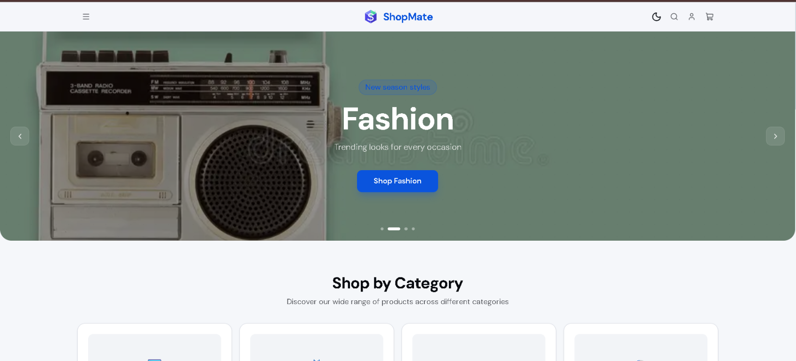
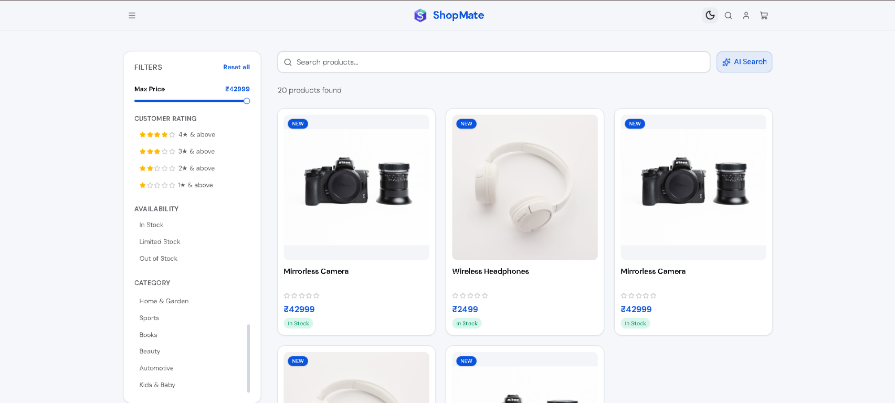
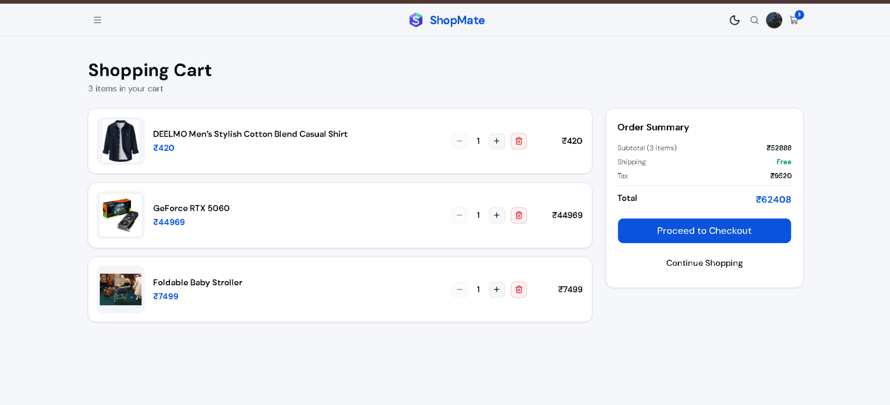
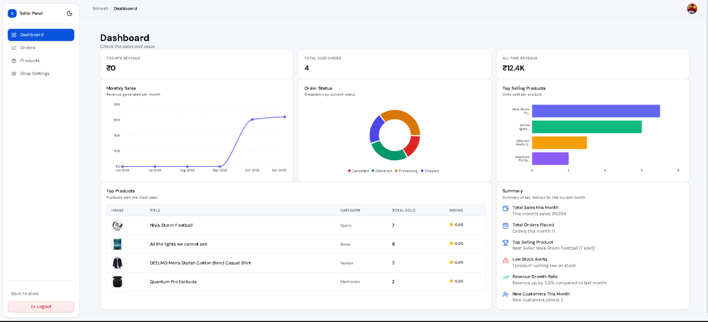
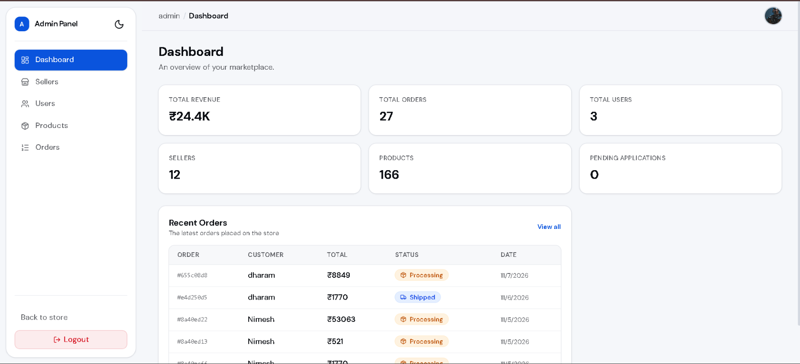

# ShopMate

- Multi-vendor marketplace with customer, seller, and admin roles
- Seller applications reviewed and approved by an administrator
- Online Razorpay payments or cash on delivery, with order cancellation
- Browse products by shop and save up to three shipping addresses
- Seller analytics charts, plus admin tools for users, products, and orders

ShopMate is a marketplace where sellers apply to operate shops and customers discover products across approved shops. It is not a multi-tenant SaaS for isolated customer-owned stores.

## Live demo

**[shopmate-store.vercel.app](https://shopmate-store.vercel.app)**

## Screenshots

### Storefront home



### Product listing



### Shopping cart



### Seller dashboard



### Admin dashboard



## What the application includes

- **Shopping:** product discovery, shop browsing, cart management, checkout, order history, and order details.
- **Payments and orders:** Razorpay online payments or cash on delivery; customers can cancel orders while they are still processing.
- **Customer accounts:** authentication, password reset emails, and up to three saved shipping addresses.
- **Reviews:** a user must have an order containing the product to submit a review. The current check does not require that the order was paid or delivered.
- **Seller workflow:** users can apply to become sellers; an admin approves or rejects applications. Approved sellers manage products and shop settings, process orders, and view dashboard charts.
- **Admin tools:** dashboard metrics and management workflows for users, seller applications, products, and orders.
- **Product recommendations:** Gemini-powered product matching.

## Technology

| Area         | Technologies                                                                                                             |
| ------------ | ------------------------------------------------------------------------------------------------------------------------ |
| Client       | React 19, TypeScript, Vite, Tailwind CSS, shadcn/ui, React Router, TanStack Query, Axios, React Hook Form, Zod, Recharts |
| Server       | Node.js, Express 5, TypeScript, MongoDB, Mongoose, Zod                                                                   |
| Integrations | Razorpay, Cloudinary, Brevo, Google Gemini                                                                               |
| Security     | JWT access and refresh tokens, HTTP-only cookies, Helmet, CORS, rate limiting                                            |
| Hosting      | Vercel (client), Render (server)                                                                                         |
| CI           | GitHub Actions, Node.js 22, npm                                                                                          |

## Repository map

```text
.
├── .github/workflows/ci.yml
├── docs/
│   └── screenshots/             # images used in this README
├── client/
│   └── src/
│       ├── api/                 # HTTP client and feature API calls
│       ├── components/          # storefront, seller, admin, and shared UI
│       ├── context/             # authentication and theme state
│       ├── hooks/               # feature data and mutation hooks
│       ├── pages/               # customer, seller, shop, and admin pages
│       └── schema/              # client-side form schemas
└── server/
    └── src/
        ├── config/              # database and third-party integrations
        ├── middlewares/         # auth, validation, access control, errors, limits
        ├── modules/             # admin, auth, cart, order, payment, product,
        │                        # review, seller, shipping, shop, and user
        └── utils/               # shared server utilities
```

## Setup

### Requirements

- Node.js 22 or newer and npm
- MongoDB Atlas
- Cloudinary credentials
- Razorpay credentials for payment flows
- Brevo credentials for email flows
- A Gemini API key for AI product recommendations

Order creation and cancellation use MongoDB transactions. A standalone local `mongod` does not support these transactions; use Atlas or configure MongoDB locally as a replica set.

### Install

From the repository root:

```bash
cd server
npm ci
cd ../client
npm ci
```

### Configure the server

Create `server/.env`:

```env
PORT=4000
NODE_ENV=development
MONGO_URI=

ACCESS_SECRET=replace_with_a_long_random_secret
REFRESH_SECRET=replace_with_a_different_long_random_secret

# Frontend origins, used for CORS and password-reset links
LOCAL_HOST=http://localhost:5173
FRONTEND_URL=http://localhost:5173

CLOUDINARY_CLOUD_NAME=
CLOUDINARY_API_KEY=
CLOUDINARY_API_SECRET=

RAZORPAY_KEY_ID=
RAZORPAY_KEY_SECRET=
RAZORPAY_WEBHOOK_SECRET=

BREVO_API_KEY=
SENDER_EMAIL=
GEMINI_API_KEY=
```

### Configure the client

Create `client/.env`:

```env
VITE_BASE_URL=http://localhost:4000/api/v1
```

The client reads `VITE_BASE_URL` as its API base URL.

### Configure Razorpay webhooks

The server accepts Razorpay webhooks at:

```text
POST /api/v1/payments/webhook
```

In the Razorpay Dashboard, create a webhook pointing to `https://<your-api-host>/api/v1/payments/webhook`, enable the `order.paid` event, and copy the webhook secret into `RAZORPAY_WEBHOOK_SECRET`. For local development, expose the local API through a secure public tunnel and use that tunnel URL in the dashboard. Do not use the Razorpay key secret as the webhook secret.

### Create the first admin

There is no first-admin seed script or public admin-registration flow. Register the account normally, then promote that account using authorized access to the target MongoDB database:

```javascript
db.users.updateOne({ email: "admin@example.com" }, { $set: { role: "admin" } });
```

Use the email of the account you registered, then sign in again and open `/admin`. The user model allows more than one admin; it does not enforce a single-admin limit.

## Run locally

Open separate terminals from the repository root.

Server:

```bash
cd server
npm run dev
```

Client:

```bash
cd client
npm run dev
```

By default, Vite serves the client at `http://localhost:5173` and the API listens on `http://localhost:4000`.

## Scripts

Run each command from its package directory.

### Server

| Command             | Description                     |
| ------------------- | ------------------------------- |
| `npm run dev`       | Run the server with `tsx watch` |
| `npm run build`     | Compile TypeScript              |
| `npm run start`     | Run the compiled server         |
| `npm run typecheck` | Type-check without emitting     |
| `npm run lint`      | Run Oxlint                      |
| `npm run format`    | Check formatting with Prettier  |

### Client

| Command           | Description                                 |
| ----------------- | ------------------------------------------- |
| `npm run dev`     | Start the Vite development server           |
| `npm run build`   | Type-check and create the production bundle |
| `npm run lint`    | Run Oxlint                                  |
| `npm run preview` | Preview the production bundle               |

The server's `npm test` script is currently a placeholder and exits with an error; no automated test suite is configured yet.

## Test payments

Use Razorpay **Test Mode** credentials in `RAZORPAY_KEY_ID` and `RAZORPAY_KEY_SECRET` while developing. Configure a test-mode webhook and its corresponding secret as well. Use Razorpay's current test payment instruments; do not enter real payment details into a development setup.

## Deployment

The live demo is split across two hosts:

| Part   | Host   | What to configure                                                                                                                                                                                                                         |
| ------ | ------ | ----------------------------------------------------------------------------------------------------------------------------------------------------------------------------------------------------------------------------------------- |
| Client | Vercel | Set `VITE_BASE_URL` to the Render API URL ending in `/api/v1`. The client is a single-page app, so Vercel must rewrite unknown paths to `index.html`; otherwise deep links such as `/shops/<id>` return a 404 when the page is refreshed. |
| Server | Render | Set every variable from the server `.env` example. `FRONTEND_URL` and `LOCAL_HOST` must be the Vercel URL so CORS and password-reset links point to the deployed client.                                                                  |

After deploying the server, point the Razorpay webhook at `https://<your-render-service>/api/v1/payments/webhook`, as described in [Configure Razorpay webhooks](#configure-razorpay-webhooks).

On Render's free plan, a service that has been idle spins down, so the first request after a quiet period can take a while to respond.

## CI

The workflow in `.github/workflows/ci.yml` runs for pushes to `main` and `develop`, and pull requests targeting `main`.

- **Server job:** Node.js 22, `npm ci`, type checking, linting, formatting check, and build.
- **Client job:** Node.js 22, `npm ci`, linting, and production build.
